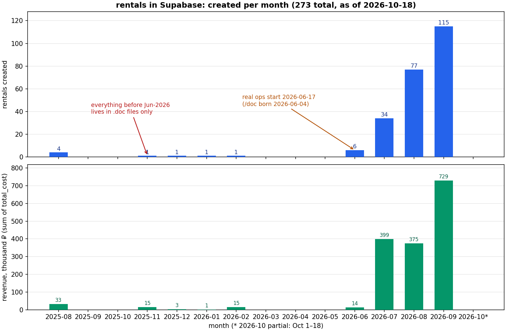

# Rentals Retrospective Investigation — baseline for backfilling pre-`/doc` rentals

**Date:** 2026-10-18 · **Task:** 107 · **Author:** Super Z (main agent)
**Purpose:** the boss wants to retrospectively import the first, manually-created rentals
(paper/`.doc` contracts from before the `/doc` bot command existed; a `.zip` with the
document archive is coming). This document records the current state of the `rentals`
table in Supabase, establishes WHEN the first rentals are, WHAT is already in the DB,
and WHAT matching keys we can use to detect which `.doc` files are **not yet** in Supabase.

All numbers below are read live from the production DB
(`inmctohsodgdohamhzag.supabase.co`, `public.rentals`) on **2026-10-18 ~12:40 UTC**.
Repro scripts: `scripts/retro-rentals-*.py` (read-only, need `SUPABASE_SERVICE_ROLE_KEY` env var).

---

## 1. Headline numbers

| Metric | Value |
|---|---|
| Total rentals rows | **273** |
| …of which test/PoC junk (pre-Jun-2026 era) | 8 |
| …of which real business rentals | **265** (all crew `vip-bike` except 3×`sly13`, 5×crew-less) |
| Earliest row at all | **2025-08-09** (`ural-bobber`, 999 ₽, test) |
| Earliest REAL rental | **2026-06-17** (`nibbler-regumoto-4v`, 6 000 ₽, completed) |
| First `doc_command`-attributed rental | **2026-07-25** (attribution key added later than the command itself) |
| Distinct renters (user_id) | 59 · vehicles involved: 70 · deposits set: 90 |
| Sum of `total_cost` | **≈ 1 885 298 ₽** (incl. test rows; ~1.82 M₽ real ops) |
| Statuses | completed 242 · cancelled 20 · pending_confirmation 6 · **active 5** |
| Payment statuses | fully_paid 250 · pending 17 · interest_paid 6 |

## 2. Timeline (created_at per month)

| Month | Count | Revenue, ₽ | Note |
|---|---:|---:|---|
| 2025-08 | 4 | 33 034 | test era (ural-bobber ×2, sauna-001 ×3 — 1 completed, rest cancelled) |
| 2025-11 | 1 | 14 900 | sauna-001, cancelled |
| 2025-12 | 1 | 2 697 | ural-bobber, cancelled |
| 2026-01 | 1 | 900 | sauna-001, cancelled |
| 2026-02 | 1 | 14 800 | `markdown-doc-poc` (PoC by Alex) |
| 2026-03 … 05 | 0 | 0 | **the blind spot — covered only by .doc files** |
| **2026-06** | 6 | 14 000 | first real ops (Jun 17–20) |
| 2026-07 | 34 | 399 141 | ramp-up; attribution+sha start Jul 25 |
| 2026-08 | 77 | 374 828 | service_work (44) + web orders appear |
| 2026-09 | 115 | 729 138 | peak |
| 2026-10 (1–18) | 33 | 301 860 | month in progress |

By actual rental period (`agreed_start_date`): Jun 6 · Jul 33 · Aug 83 · Sep 106 · Oct 32 ·
13 rows have NULL agreed dates (all pre-Jul-2026 or test rows).
**No rental exists with an agreed period before 2026-06-17** — i.e. the whole
"manual contracts" history (which per the boss goes back well before June 2026) is
currently **absent** from the DB. That is exactly the gap the `.zip` of `.doc` files will fill.



## 3. The four eras of the data

### Era 0 — tests (2025-08 … 2026-02), 8 rows
All created by `salavey13` (413553377) or PoC user Alex (829681958). No `metadata.source`,
no renter names, `agreed_*` all NULL. Full list:

| created_at (UTC) | vehicle | status | total | renter (users.full_name) |
|---|---|---|---:|---|
| 2025-08-09 15:32 | ural-bobber | completed | 999 | Gg (mister_x_420) |
| 2025-08-12 16:04 | sauna-001 | cancelled | 6 000 | Paul (self) |
| 2025-08-20 18:07 | sauna-001 | cancelled | 18 100 | Paul (self) |
| 2025-08-21 19:43 | sauna-001 | cancelled | 7 935 | Paul (self) |
| 2025-11-19 01:14 | sauna-001 | cancelled | 14 900 | Paul (self) |
| 2025-12-23 00:52 | ural-bobber | cancelled | 2 697 | Paul (self) |
| 2026-01-02 21:33 | sauna-001 | cancelled | 900 | Paul (self) |
| 2026-02-27 12:54 | «1.5 лето флора 2» | pending_confirmation | 14 800 | Alex (PoC `markdown-doc-poc`) |

→ Recommendation: keep them (history), but tag/exclude them from revenue analytics;
they must not confuse the `.doc` matching (none of them have renter names).

### Era 1 — `/doc` command born, attribution not yet written (2026-06-04 … 2026-07-24)
Git: `01f348cf` 2026-06-04 "(feat): VLM-first /doc command, ФЗ-152 consent flow & bike catalog tie";
manual fallback `65e7d279`/`c1d60ae7` 2026-06-08/09. First real rentals land **2026-06-17**:

| created_at | id | vehicle | agreed period | total | fingerprint |
|---|---|---|---|---:|---|
| 06-17 15:12 | b99d89ef | nibbler-regumoto-4v | 06-17→06-18 | 6 000 | only `history`, `odometer_after=69` |
| 06-19 18:27 | b5df82cc | suzuki-gsx-s1000f | 06-20 | NULL | only `history`, `odometer_after=1235` |
| 06-19 18:49 | 9ce7cabb | suzuki-gsx-s1000f | 06-20 | NULL | `backfill_from_artifacts` 06-23, `original_contract_key=rental-suzuki-gsx-s1000f-1781894985702` |
| 06-19 18:50 | f65bf618 | suzuki-gsx-s1000f | 06-20 | NULL | same backfill, key …-1781895028775 |
| 06-19 23:25 | 17d4089c | nibbler-regumoto-4v | 06-20→06-21 | NULL | only `history`, `odometer_after=2` |
| 06-20 23:53 | 034bb19b | nibbler-regumoto-4v | 06-21 | 8 000 | backfill, `daily_price=6000` |

Note: 3×suzuki-gsx on 06-19/20 with almost identical timestamps looks like re-issued
contracts for the same deal (18:27 / 18:49 / 18:50). The three "bare" rows (no source)
were completed in a bulk sweep on **2026-07-20** (`metadata.history[0].by` = internal bot ids).
There are also 25 source-less July rentals (Jul 8–24) — early flows before attribution;
they carry only `auto_closed*` keys (stale-active sweep of 2026-07-26).

### Era 2 — attributed /doc (2026-07-25 …)
`metadata.source="doc_command"` + `metadata.doc_sha256` (sha256 of the generated contract file)
appear from **2026-07-25** (first: `be839f2f`, bmw-f800r, 12 000 ₽). Counts by month:
Jul 9 · Aug 30 · Sep 57 · Oct 20 = **116** rentals; **133** rows have `doc_sha256`
(includes 3 `doc_command_recovery`, 10 older source-less rows got sha on later re-issues).

### Era 3 — new channels (Aug 2026 …)
- `service_work` from 2026-08-08 (44 rows) — service ops on `vip-bike-svc-0xx` pseudo-vehicles;
- `franchize_web_order` from 2026-08-26 (53 rows) — web storefront, carries `document_key`/`order_id`/`flow_type`;
- one-offs: `ekip_command`, `claude_bot`, `bike_swap_owner_fix`, `owner_voice_backfill` (2026-10-17 — evidence that retro-backfills into this table are already a thing).

## 4. Who creates / who rents

Operators (`created_by_operator_chat_id`): **DJORUDJOV 7813830016 → 184**, None 53,
salavey13 413553377 → 23, 5219192922 → 6, singletons ×8 (incl. I_O_S_NN 356282674 → 1).

⚠️ **Renter attribution pattern (critical for the import):** 180 of 273 rows carry
`user_id = 356282674` (Илья I.O.S. / I_O_S_NN — the crew owner). That is the walk-in pattern:
the rental is booked "on" the operator's user account and the **real renter is stored only in
`metadata.renter_name` / `metadata.renter_phone`** — present on 49 of those 180
(only since ~2026-08-19); `service_work` rows (44) legitimately have no renter at all.
Older /doc rows (Jul, early Aug) have NEITHER user identity NOR renter_name —
so person-level history before Aug-2026 exists only in the `.doc` files.
Phone formats are inconsistent: `+79107905858` vs `89290536660` — normalize before matching.

## 5. Matching keys for the `.zip` import (the next iteration)

Exact keys, in order of reliability:
1. **`metadata.doc_sha256`** (133 rows) / **`metadata.original_sha256`** (rows recovered by
   `backfill_from_artifacts`) — sha256 of the contract file. Only works if the `.zip` contains
   the SAME bytes (generated `.docx` re-issues). Compute sha256 per file in the zip and lookup.
2. **`metadata.original_contract_key`** — pattern `rental-<vehicle_id>-<unix_ms>` (artifact recovery).
3. **`metadata.document_key`** / `order_id` (franchize web orders, 53 rows) — not relevant for paper docs.

Fuzzy keys (for pre-system paper contracts — no sha exists for them):
- `metadata.renter_name` (ФИО) + `renter_phone` (normalized to +7XXXXXXXXXX)
- `vehicle_id` (bike) + `agreed_start_date`/`agreed_end_date` window ±1–2 days
- `total_cost` ± small delta; `deposit_amount`
- `.doc` content itself: VLM/LLM extraction (the `/doc` pipeline already does VLM-first
  parsing — reuse `app/webhook-handlers/commands/doc-manual.ts` extraction prompts where possible)

Watch-outs:
- `.doc` (legacy binary) ≠ `.docx`: text extraction needs `antiword`/`catdoc`/`libreoffice --headless --convert-to txt` or VLM-on-converted-PDF;
- the 3×suzuki-gsx 06-19/20 trio shows the same deal CAN legitimately have several contract re-issues — dedupe rule must tolerate that (match to the same rental, don't create N new ones);
- `created_at` of inserted retro rows should be the **contract date** (from the doc), with
  `metadata.source="retro_backfill_v1"` + full audit trail in `metadata.history`
  (precedent: `owner_voice_backfill` 2026-10-17, `backfill_from_artifacts` 2026-06-23);
- required NOT-NULL-ish fields: `user_id` (fallback walk-in account 356282674), `vehicle_id`
  (must exist in `cars` — all 70 current vehicle_ids resolve), `owner_id`, `status="completed"`,
  `payment_status`, `crew_id=2d5fde70-1dd3-4f0d-8d72-66ccf6908746` (vip-bike) unless doc says otherwise;
- idempotency: keep an import manifest (file sha256 → action taken → rental_id) so re-running
  the import never duplicates; a dedicated `metadata.import_batch` tag is enough.

## 6. Open questions for the boss (before the `.zip` lands)

1. Which period does the archive actually cover? (earliest known real ops ≈ before Jun-2026 — how far back?)
2. Should cancelled/no-deal paper contracts be imported as `cancelled`, or skipped?
3. `service_work`-style operations recorded on paper — in scope?
4. For walk-ins: is creating a minimal `users` row per new renter desirable (currently NO —
   rentals since Jun all ride the I_O_S_NN account), or keep the walk-in pattern?
5. What is the source of truth for bikes that are NOT yet in `cars` (archive may mention sold/old bikes)?

## 7. Repro

```
# all read-only; set SUPABASE_SERVICE_ROLE_KEY first
python3 scripts/retro-rentals-investigation.py   # totals, timeline, statuses, crews, users, vehicles
python3 scripts/retro-rentals-deep-dive.py       # pre-/doc era detail, revenue, artifacts
python3 scripts/retro-rentals-round3.py          # corrected users/cars lookup, renter attribution
python3 scripts/retro-rentals-round4.py          # milestones per source, doc linkage samples
```

Schema notes: `rental_contract_artifacts` lives in the **`private`** schema (not exposed via
PostgREST — access through service role/SQL only). `users` PK is `user_id` (text), full name in
`full_name`; `cars` has `make`/`model`/`daily_price`/`crew_id`. Rentals PK `rental_id` (uuid).
